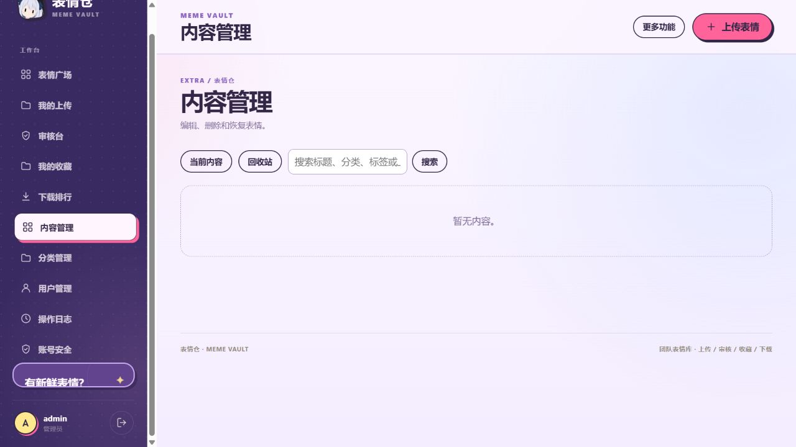
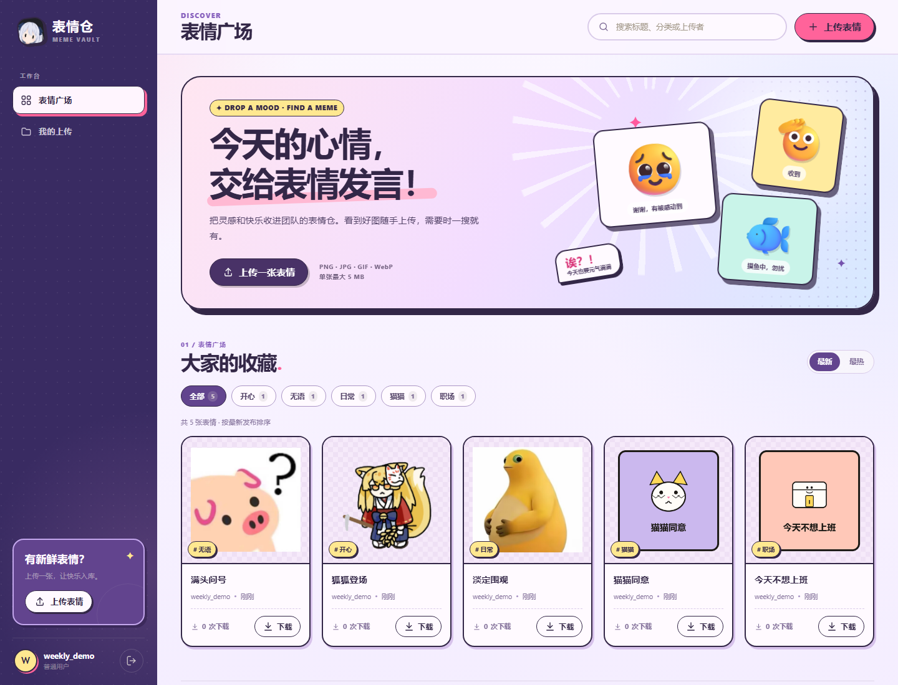
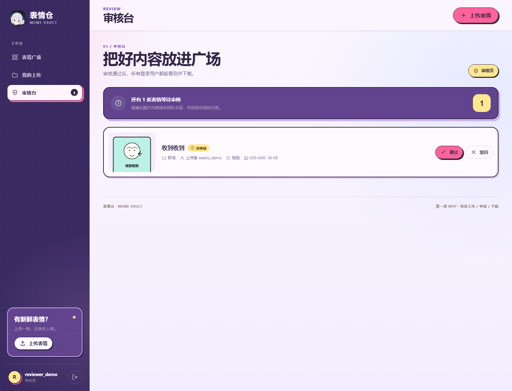
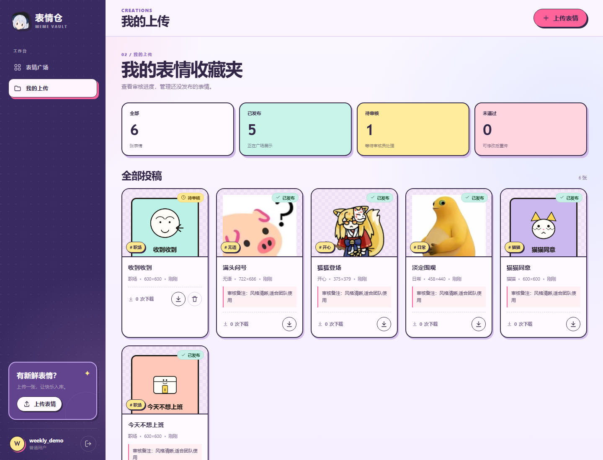
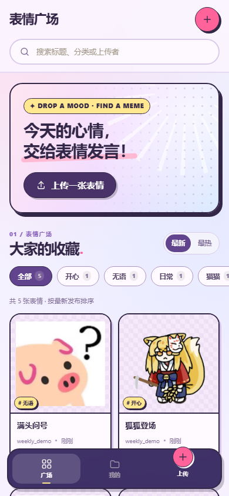

# 表情仓 · Meme Vault

一个用于团队共享表情包的轻量 Web 应用。基于 **Node.js 22 + 内置 SQLite + 原生前端**，零第三方 npm 依赖。

当前版本支持：**注册/登录 → 批量上传 → 审核 → 分类与检索 → 收藏/下载 → 管理与恢复**。

> 阶段简报：[Word 版](report/表情仓第一周项目简报.docx) · [PDF 版](report/表情仓第一周项目简报.pdf)




## 首周已完成

- 账号注册、登录、退出，密码加密存储，登录会话使用 HttpOnly Cookie。
- 普通用户单张上传 PNG / JPG / GIF / WebP，最大 5 MB，自动识别真实图片格式并读取宽高。
- 审核员/管理员审核队列，可通过或驳回并填写驳回原因。
- 表情广场按最新/最热排序，支持标题、分类、上传者搜索和分类筛选。
- 我的上传：查看全部投稿、审核状态、审核备注，删除未通过/待审核内容。
- 单张下载，服务端返回 `attachment` 下载头，下载次数累加。
- 普通用户、审核员、管理员三种角色，界面与接口双重权限校验。
- 响应式界面，支持桌面端与移动端。

## 第二阶段已完成

- 一次多选或拖拽最多 10 张图片，逐张校验格式与大小；审核台可批量通过或驳回最多 50 条。
- 管理员可管理分类、编辑任何表情的标题/分类/标签、将内容移入回收站并恢复。
- 表情支持标签、收藏、下载排行，以及最多 20 张图片的 ZIP 打包下载。
- 管理员可调整用户角色、停用/启用账号、重置密码，查看审核及管理操作审计日志。
- 用户可修改自己的密码、查看并移除其他登录设备。角色变更与管理员重置密码会使目标用户现有会话失效。
- 浏览器上传时生成 WebP 缩略图；非 GIF 图片在压缩明显有效时使用压缩版。可配置 S3 兼容对象存储，默认仍使用本地文件。
- 按 IP 或用户分别限制注册、登录、上传、审核、打包下载和密码操作频率。

## 预览

| 表情广场                                 | 审核台                                 |
| ------------------------------------ | ----------------------------------- |
|  |  |

| 我的上传 | 移动端 |
| --- | --- |
|  |  |

## 快速开始

要求 **Node.js ≥ 22.5**（项目使用内置 `node:sqlite`）。

```bash
npm start
```

打开 <http://127.0.0.1:3000>。**不需要 `npm install`**，项目没有任何第三方依赖。

首次启动会自动创建开发环境示例账号：

| 用户名 | 密码 | 角色 |
| --- | --- | --- |
| `admin` | `Admin@123456` | 管理员 |
| `reviewer` | `Review@123456` | 审核员 |

> 以上密码仅限本地开发。部署到云端前必须关闭示例账号或替换密码，见「部署」一节。

运行后端集成测试：

```bash
npm test
```

## 角色权限

| 能力 | 普通用户 | 审核员 | 管理员 |
| --- | :---: | :---: | :---: |
| 注册/登录、浏览已发布表情 | ✓ | ✓ | ✓ |
| 批量上传（最多 10 张） | ✓（待审核） | ✓（直接发布） | ✓（直接发布） |
| 下载已发布表情 | ✓ | ✓ | ✓ |
| 查看自己的待审核内容 | ✓ | ✓ | ✓ |
| 审核通过/驳回 | — | ✓ | ✓ |
| 删除自己的待审核/未通过内容 | ✓ | ✓ | ✓ |
| 批量审核 | — | ✓ | ✓ |
| 管理分类、内容回收站、用户角色与审计日志 | — | — | ✓ |
| 收藏、排行与 ZIP 下载 | ✓ | ✓ | ✓ |

管理员管理入口位于侧边栏或移动端「更多功能」菜单。

## 使用流程

1. 打开首页，注册一个普通用户。
2. 点击「上传表情」，选择或拖入最多 10 张图片、填写分类与标签并提交。单张上传可自定义标题；批量上传使用文件名作为标题。
3. 普通用户的内容进入待审核状态；审核员/管理员的上传会直接发布。
4. 用审核员账号进入「审核台」，通过或驳回内容。
5. 审核通过后，所有登录用户都能在表情广场看到并下载。

## 技术方案

- **HTTP 服务**：`node:http`，无框架。
- **数据库**：Node.js 内置 `node:sqlite`，文件位于 `data/meme-vault.db`。
- **图片存储**：图片存放在 `uploads/`，数据库只保存随机文件名和元数据；可选同步到 S3 兼容对象存储，本地文件丢失时从对象存储恢复。上传目录不在静态目录中。
- **压缩与缩略图**：浏览器用 Canvas 生成 WebP 缩略图，非 GIF 图片在压缩后体积至少减少 10% 时上传压缩版；GIF 原图保留动画。服务端再次校验缩略图格式、体积与尺寸。
- **上传解析**：基于 Web `FormData`，不依赖 multer。
- **密码**：`scrypt` 加盐哈希，格式中包含参数与 salt。
- **会话**：随机 32 字节 token，数据库只保存 SHA-256 摘要；Cookie 为 `HttpOnly + SameSite=Strict`，生产环境默认 `Secure`。
- **图片校验**：读取 PNG/JPEG/GIF/WebP 文件头与尺寸，不信任客户端 MIME，不接受 SVG。
- **安全**：参数化 SQL、同源写请求校验、CSP、`X-Content-Type-Options`、上传大小限制、登录失败限流。

### 目录结构

```text
.
├─ public/                  # 登录页、应用界面、CSS、原生 JS
├─ src/
│  ├─ app.js                # HTTP 路由、权限、上传与下载
│  ├─ config.js             # 环境变量配置
│  ├─ database.js           # SQLite 表结构与初始账号
│  ├─ images.js             # 图片格式/尺寸识别与文本清洗
│  └─ security.js           # 密码、会话、Cookie 工具
├─ scripts/create-user.js   # 创建账号 / 重置密码 / 修改角色
├─ test/app.test.js         # 后端集成测试
├─ server.js                # 启动入口
├─ data/                    # 运行时数据库（自动创建，已 gitignore）
└─ uploads/                 # 运行时图片（自动创建，已 gitignore）
```

## API 摘要

| 方法 | 路径 | 说明 |
| --- | --- | --- |
| POST | `/api/auth/register` | 注册并自动登录 |
| POST | `/api/auth/login` | 登录 |
| POST | `/api/auth/logout` | 退出 |
| GET | `/api/auth/me` | 当前用户 |
| GET | `/api/emojis` | 已发布列表，支持 `q`、`category`、`sort`、`page`、`pageSize` |
| POST | `/api/emojis` | 1–10 张上传，`multipart/form-data`，可重复 `file`、`thumbnail`，支持 `title`、`category`、`tags` |
| GET | `/api/emojis/mine` | 我的全部投稿 |
| GET | `/api/emojis/:id/image` | 受权限保护的图片预览 |
| GET | `/api/emojis/:id/thumbnail` | 缩略图；未生成时返回原图 |
| GET | `/api/emojis/:id/download` | 下载原图并计数 |
| PATCH | `/api/emojis/:id` | 修改标题/分类（本人待审核内容或管理员） |
| DELETE | `/api/emojis/:id` | 删除（本人待审核内容或管理员） |
| GET | `/api/categories` | 已发布分类及数量 |
| GET | `/api/review/queue` | 待审核队列（审核员/管理员） |
| POST | `/api/emojis/:id/review` | 通过/驳回（审核员/管理员） |
| POST | `/api/review/batch` | 批量审核 1–50 条 |
| GET/POST/PATCH/DELETE | `/api/categories[/:id]` | 分类列表与管理员维护 |
| GET/POST/DELETE | `/api/favorites[/:id]` | 收藏列表与切换 |
| GET | `/api/rankings` | 下载前 20 名 |
| POST | `/api/emojis/download-zip` | 1–20 张打包下载 |
| GET | `/api/admin/emojis` | 管理员查看当前内容或回收站 |
| POST | `/api/admin/emojis/:id/restore` | 恢复误删内容 |
| GET/PATCH/POST | `/api/admin/users[/:id/role|/:id/status|/:id/password]` | 用户列表、角色、停用/启用与密码重置 |
| GET | `/api/admin/audit` | 审计日志 |
| POST | `/api/auth/password` | 登录用户修改密码 |
| GET/DELETE | `/api/auth/sessions[/:id]` | 查看与移除登录设备 |

## 配置

复制 `.env.example` 为 `.env`，或直接使用部署平台的环境变量。`npm start` 会自动读取项目根目录的 `.env`。

| 变量 | 默认值 | 说明 |
| --- | --- | --- |
| `HOST` | 开发 `127.0.0.1` / 生产 `0.0.0.0` | 监听地址 |
| `PORT` | `3000` | 监听端口 |
| `NODE_ENV` | 空 | 设为 `production` 启用生产 Cookie 策略 |
| `SEED_DEMO_ACCOUNTS` | `1` | 设为 `0` 关闭初始示例账号 |
| `ADMIN_USERNAME` / `ADMIN_PASSWORD` | `admin` / 开发默认密码 | 生产环境示例管理员账号 |
| `REVIEWER_USERNAME` / `REVIEWER_PASSWORD` | `reviewer` / 开发默认密码 | 生产环境示例审核员账号 |
| `COOKIE_SECURE` | 开发 `0` / 生产 `1` | HTTPS 部署必须为 `1` |
| `TRUST_PROXY` | `0` | 在反向代理后设为 `1`，用于获取真实客户端 IP |
| `DATA_DIR` | `./data` | 数据库目录 |
| `UPLOAD_DIR` | `./uploads` | 图片目录 |
| `S3_ENDPOINT` / `S3_BUCKET` | 空 | 同时设置全部 S3 配置后启用对象存储；远程地址须使用 HTTPS |
| `S3_REGION` | `us-east-1` | S3 区域 |
| `S3_ACCESS_KEY_ID` / `S3_SECRET_ACCESS_KEY` | 空 | 对象存储访问密钥 |

## 部署到云端

### 1. 准备账号（推荐）

云端首次部署不要使用开发默认密码。关闭示例账号，再用命令行创建管理员和审核员：

```powershell
# Windows PowerShell
$env:NODE_ENV = "production"
$env:SEED_DEMO_ACCOUNTS = "0"
$env:COOKIE_SECURE = "1"
$env:NEW_USER_PASSWORD = "替换为至少12位的强密码"
npm run create-user -- admin admin

$env:NEW_USER_PASSWORD = "另一个强密码"
npm run create-user -- reviewer reviewer

npm start
```

```bash
# Linux / macOS
export NODE_ENV=production
export SEED_DEMO_ACCOUNTS=0
export COOKIE_SECURE=1
export NEW_USER_PASSWORD='替换为至少12位的强密码'
npm run create-user -- admin admin

export NEW_USER_PASSWORD='另一个强密码'
npm run create-user -- reviewer reviewer

npm start
```

`create-user` 也用于重置密码；重置后该账号已有会话会全部失效。

### 2. 持久化目录

必须把以下两个目录挂载到持久化磁盘：

- `data/`：SQLite 数据库（包含 WAL 文件）。
- `uploads/`：表情原图。

两者要一起备份，避免数据库记录与图片文件不一致。不要把 `uploads/` 暴露成静态目录。

### 3. HTTPS 与反向代理

生产环境默认 `COOKIE_SECURE=1`，因此浏览器必须通过 HTTPS 访问，否则登录 Cookie 不会写入。Nginx 示例：

```nginx
server {
    listen 443 ssl;
    server_name meme.example.com;

    client_max_body_size 6m;

    location / {
        proxy_pass http://127.0.0.1:3000;
        proxy_set_header Host $host;
        proxy_set_header X-Forwarded-For $proxy_add_x_forwarded_for;
        proxy_set_header X-Forwarded-Proto $scheme;
    }
}
```

应用侧同时设置 `TRUST_PROXY=1`，登录限流才会使用真实客户端 IP。

### 4. 检查清单

- [ ] `NODE_ENV=production`
- [ ] `SEED_DEMO_ACCOUNTS=0`，或已替换默认密码
- [ ] 使用 HTTPS，`COOKIE_SECURE=1`
- [ ] `data/`、`uploads/` 已挂载持久化卷并纳入备份
- [ ] 反向代理限制请求体大小（建议 6 MB）
- [ ] 不将 `uploads/` 直接暴露给公网
- [ ] 首次部署后登录管理员账号，实际上传、审核、下载各走一遍

## 当前限制

- 单张最大 5 MB，格式为 PNG / JPG / GIF / WebP；每批最多 10 张，ZIP 最多 20 张。
- 「我的上传」一次最多返回 200 条；公开列表使用分页「再看一些」。
- 没有邮件找回或邮箱验证；忘记密码需由管理员重置。审计日志记录操作类型与详情，不保存每次修改前的完整快照。
- 缩略图和压缩由现代浏览器生成；旧客户端上传的图片会直接使用原图预览。
- 图片内容安全依赖团队内部使用；若向公网开放，建议增加恶意文件扫描、对象存储和 CDN。

## 下一阶段建议

1. 为忘记密码流程接入可信邮箱服务，并增加管理员二次验证。
2. 为管理员列表增加状态与时间组合筛选，为审计日志增加导出和保留周期。
3. 在服务端生成缩略图，覆盖不经过浏览器界面上传的客户端；增加异步图片处理任务。

## 验证记录

- `npm test`：14 项测试通过，覆盖原有闭环与批量操作、收藏/ZIP、内容恢复、分类/角色、密码/设备、缩略图和 S3 兼容存储。
- 无头 Edge 真实浏览器闭环：注册 → 上传 → 审核员通过 → 广场展示 → 搜索 → 下载，浏览器实际下载文件与上传文件字节一致。
- 桌面 1440×1000、移动端 390×844 截图检查，无横向溢出。
